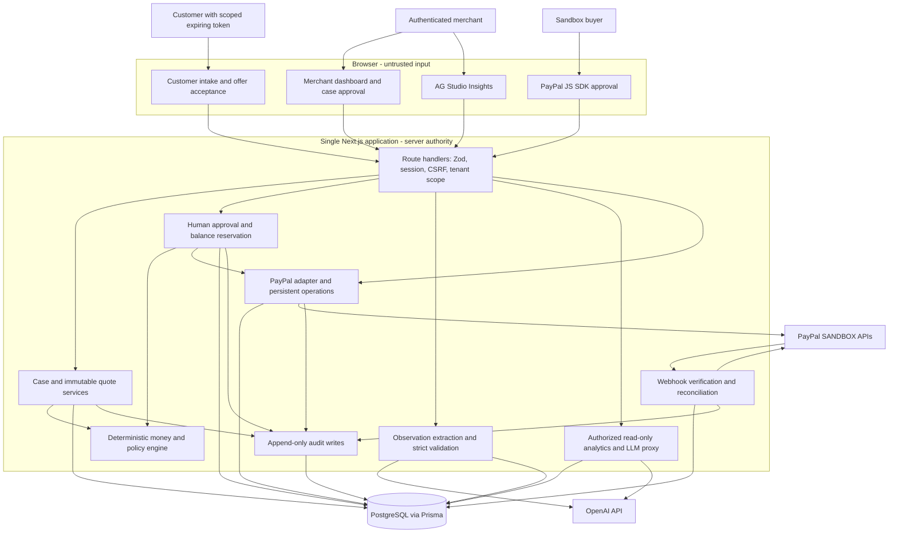

# ReturnWise AI architecture proposal

Planning baseline: 2026-11-08. This is a design, not an implemented or externally validated system. Read with [milestones](implementation-plan.md), [data model](data-model.md), [risks](risks.md), [configuration](environment.md), and [baseline checks](baseline.md).

## System boundaries

One Next.js App Router application, Node runtime, strict TypeScript, PostgreSQL/Prisma. Route handlers authenticate, validate with Zod, and call server services. Services own policy, transactions, and audit; adapters own provider I/O. React renders server-authoritative results. No queues, Redis, microservices, autonomous refund agents, or live-money configuration.



The webhook entry point uses provider-signature verification, not a merchant cookie. Its tenant is derived from trusted local configuration and verified resource ownership, never a webhook-supplied tenant ID. Both AI entry points lack payment tools. Insights may modify its local dashboard layout, but its server tools are read-only and cannot issue arbitrary SQL.

## First real payment slice

Start with one configured sandbox merchant, USD, one purchase unit, one capture per application order, and one full-refund-keep decision per case. Reject unsupported currencies, multi-capture shapes, and unverified/imported payments. Additional tenant fixtures exercise authorization but do not inherit the configured merchant's payment credentials.

1. Authenticated merchant creates a checkout for a persisted order with a server-set total. Persist a create operation and request ID before contacting PayPal. Bind buyer checkout access to a short-lived, order-scoped capability.
2. Buyer approves in the PayPal sandbox UI. A browser callback is a request to verify/capture, not evidence of payment. Capture the stored PayPal order using its own persisted request ID.
3. Validate capture ID, order association, payee merchant ID, currency, amount and provider state. Store verification timestamps and provenance. A pending capture cannot fund a refund.
4. Merchant records policy eligibility and any manual entitlement assessment. Create an immutable quote; merchant explicitly confirms its amount, currency and resolution. AI is not required for this slice.
5. In a short DB transaction, recheck authorization, case version, policy version, quote expiry, conditions and balance. Create exactly one decision and one refund operation, reserve its amount, and append audit. Duplicate approval returns the existing operation.
6. Outside that transaction, the server submits the persisted refund request. The first full-refund case uses `{}` only if the fresh verified balance equals the approved original capture amount and there are no prior refunds or unresolved operations. Partial refunds later use an explicit approved amount object. Persist the exact payload and its hash; retries cannot change it.
7. Validate the returned refund resource and, where needed, fetch it by ID. Complete the case only when a verified refund with matching capture, amount and currency is `COMPLETED`. Missing fields, timeout, mismatches and unknown statuses keep the operation unresolved.

PayPal documents create/capture in [Orders v2](https://developer.paypal.com/api/orders/v2), capture refunds in [Payments v2](https://developer.paypal.com/api/payments/v2/captures-refund), and subsequent [refund lookup](https://developer.paypal.com/api/payments/v2/refunds-get). Endpoint details and verification limitations are recorded in [provider notes](provider-notes.md).

```mermaid
sequenceDiagram
    participant H as Merchant
    participant S as Server
    participant D as PostgreSQL
    participant P as PayPal sandbox
    H->>S: Approve persisted quote and case version
    S->>P: Verify known capture and refund state
    P-->>S: Authoritative resource details
    S->>D: Transaction: lock capture, validate, reserve, decision, operation, audit
    D-->>S: Durable request ID and immutable payload
    S->>D: Claim operation with bounded lease
    S->>P: POST capture refund with same stored request ID
    alt Verified matching COMPLETED refund
        P-->>S: Refund resource
        S->>D: Transaction: ledger, completion, release reservation, audit
        S-->>H: Completed with actual refund ID
    else Pending, ambiguous response, timeout or crash
        S->>D: Keep reservation; pending or needs reconciliation
        S-->>H: Pending verification; no success claim
        S->>P: GET known refund or reconcile original operation
        P-->>S: Verified state or still unresolved
    end
```

DB locks serialize application operations; they cannot lock PayPal or prevent a merchant using PayPal's dashboard concurrently. Unexpected external activity freezes the capture until accounted for. The first demo uses fresh captures and no dashboard-side refunds. Provider rejection and response mismatch handling remain mandatory.

## Financial contract

- Store money as PostgreSQL `bigint` / Prisma `BigInt`; compute with JavaScript `bigint`. API JSON carries integer minor units as decimal strings. Parse PayPal decimal strings by digits and currency exponent, never `parseFloat`, multiplication by `100` on a Number, or rounding an unvalidated input.
- MVP accepts `USD` only, exponent 2, with a conservative configured-in-code demo transaction ceiling of 100,000 minor units. Reject fractional minor units, signs, scientific notation, unsupported currency and amounts outside the limit. Never silently convert currency. Broader currency support requires an explicit exponent registry and new tests.
- `available = capturedMinor - verifiedCompletedRefundsMinor - unresolvedReservationsMinor`. Count each provider refund once by its unique ID; do not double-count an operation's reservation when its completed refund is booked. Provider-pending external refunds also consume capacity. If totals or completeness are unknown, available balance is unknown and execution stops.
- Initial refunds require a verified completed capture. Later partials may use a capture known to have completed and now partially refunded only after reconciling all known refunds and detecting unexplained changes. Fully refunded, reversed, denied, pending or unknown captures are blocked.
- Full keep modeled cost = full refund + keep-specific processing cost. Full return modeled cost = full refund + reverse shipping + handling - expected recovery. Partial keep modeled cost = explicitly accepted partial refund + processing cost. Negative modeled net cost can be meaningful; a negative refund can never be valid.
- Compare cost only within equivalent, policy-eligible entitlements. Do not promote a partial refund because it costs less than a full entitlement. Rights/policy ambiguity routes to human review, not a legal conclusion. Quotes snapshot rules, inputs, sources, calculator version and assumption provenance.
- Example fixture only: `8000 + 1800 + 700 - 1200 = 9300` cents for return versus `8000` cents for keep; `1300` cents is a **modeled** difference, never a measured saving.

## Durable execution and reconciliation

Local operation states: `PENDING`, `PROCESSING`, `PROVIDER_PENDING`, `NEEDS_RECONCILIATION`, `COMPLETED`, `FAILED_FINAL`. Approval is a decision state. Keep raw provider status separate. UI maps unresolved states to pending/processing and exposes a useful explanation; unknown states never become completed by default.

Claim one operation using a DB lease; commit before network I/O. Record first-send time, attempt count, request hash and request ID. An expired lease means the worker may have sent the request: it requires reconciliation, not a fresh operation. Never hold a DB transaction across PayPal/OpenAI calls.

For a known refund ID, use `GET /v2/payments/refunds/{refund_id}` and validate its link to the stored capture. With a missing refund ID, reconcile the original request and verified webhook evidence; a capture total alone cannot prove which operation succeeded. Same-key POST replay is allowed only within an endpoint retention window confirmed before implementation and with the identical payload. Until that window is established, disable automatic POST replay. After expiry or unresolved external activity, retain the reservation and require manual investigation. There is no assumed lookup-by-request-ID or list-refunds-for-capture API. PayPal's [idempotency guidance](https://developer.paypal.com/api/rest/reference/idempotency/) explicitly makes retention endpoint-specific.

Use the DB operation table as durable work storage. In the initial local app, an authenticated reconciliation action resumes bounded batches after a restart. Webhooks also trigger bounded reconciliation. Later, an approved host scheduler can invoke the same service; no detached promises after a server response and no queue infrastructure are needed.

Webhook processing: enforce body size/header checks, verify with PayPal, then insert the unique event ID. Do not let an unverified event poison deduplication. Persist a redacted resource summary sufficient to retry processing, and acknowledge only durable receipt. Verification failures or provider verification outages cannot mutate payment state. Separate receipt from processed status so duplicates can resume incomplete work. Re-read provider resources; do not apply arrival-order overwrites. Explicitly handle verified reversals as new facts while retaining historical completed events.

## Auth, customer consent and AI

Proposed demo auth uses locally issued, cryptographically random, single-use merchant login links plus opaque, revocable database sessions. Tokens are stored only as hashes, bounded in lifetime, and never logged. Merchant identity and role come from the session. Cookies are HttpOnly, SameSite and Secure on HTTPS; mutations require trusted origin/CSRF checks. No public endpoint can mint merchant credentials.

Customer intake and acceptance capabilities are separate from merchant sessions. Each is scoped to one tenant/order and purpose, with expiry and atomic consumption. Tracking is a separate read-only capability. Partial acceptance records the exact immutable quote/terms hash, amount, currency and consent time; changed or expired quotes require fresh acceptance. A full-return refund waits for the policy's recorded return/inspection condition, unless an explicit policy permits earlier refund. No shipping-provider action is implied.

Text claims work without uploads. Optional images come later with private storage and validated size/type; no arbitrary URL fetches. The observation service uses server-side Structured Outputs plus Zod, stores model/schema/prompt versions and input hash, and falls back to manual review on refusals, invalid/incomplete responses or outages. It has no money, entitlement, approval or PayPal fields. See [OpenAI Structured Outputs](https://developers.openai.com/api/docs/guides/structured-outputs).

AG Studio receives tenant-scoped, minimized projections from persisted cases, quotes and payments. Label sandbox payments separately from simulated estimates; no customer text/photos in analytics prompts by default. The authenticated proxy allowlists model, payload size and read-only tool schemas; no arbitrary provider URL, key, SQL or refund tool from the browser. See [AG Studio Agent Quick Start](https://www.ag-grid.com/studio/react/ai-quickstart/).
