# Phase 5 — case-linked refund orchestration

Implementation and genuine vertical slice verified 2026-11-11. The user explicitly approved a new $5.00 Sandbox purchase/capture and $5.00 full returnless refund, personally approved the buyer checkout, reviewed the evidence and authorized the refund in the merchant UI. The historical fully refunded capture was excluded. No AG Studio work.

## Narrow implementation plan

1. Add an immutable case/proposal binding to existing RefundApproval, receipt verification fields and financial case states. Preserve prior schema, payment service, UTC sessions and test isolation.
2. Bind the persisted approved proposal, policy snapshot, evidence revision, exact acceptance, capture and amount under case/payment locks. Freeze the case before handing its approval to existing PaymentService; reuse its reservation, request ID, settlement and reconciliation. No transaction spans network I/O.
3. Add reviewed observational context to the deterministic engine, final merchant confirmation and customer verified-payment status. AI has no financial authority.
4. Add mocked full/partial/physical-return/race/recovery/security coverage, run complete checks, document modeled impact and judge walkthrough. Only then request explicit approval for one concrete small Sandbox purchase/refund and obtain genuine buyer approval.

Files: additive Prisma migration/schema; return/evidence/payment services plus a small case-refund binding module; existing case/customer UI and a case-refund API; focused unit/integration/E2E tests; demo setup/impact scripts and documentation.

## Review scope and provider guidance

Reviewed Phase 3/4 reports, capability authorization, evidence consent/private reads, immutable evaluations/proposals, policy/ledger checks and PayPal reservation/settlement/reconciliation. Existing timeout uncertainty is retained. New binding must prevent standalone refund endpoints from bypassing a case authorization, and webhook settlement must also update linked cases. Case-to-payment lock ordering must remain consistent.

APIMatic 0.4.1 TypeScript integration/resilience guidance was read for durable claims, unknown-outcome recovery, transport timeouts and logging boundaries. Its generated-SDK-specific setup gates do not apply: this project preserves its verified native REST provider and installs no SDK. Official PayPal [Payments v2](https://developer.paypal.com/api/payments/v2) and [idempotency](https://developer.paypal.com/api/rest/reference/idempotency/) documentation were checked. No new endpoint or inferred SDK signature is introduced.

## Implemented binding and lifecycle

`CaseRefundService` bridges existing case/proposal records to the existing `RefundApproval` and `PaymentService`. It adds no provider implementation. Final confirmation binds the immutable proposal/evaluation, policy snapshot, exact amount/currency, order/capture, evidence revision and physical receipt. Client requests contain case/proposal versions and hash, never an authoritative amount. A unique case/proposal approval prevents duplicate logical refunds.

Case locks precede payment locks. Reservations and authorization commit before network I/O. Existing leases, persisted payloads/request IDs and provider verification remain authoritative. A linked case cannot use the standalone transaction refund route to bypass case authorization. Pre-existing standalone approvals are rechecked too. Frozen case proposals/evidence cannot be edited during execution. Merchant identity/role and tenant ownership are checked server-side, including recovery. No long database transaction spans an API call.

```mermaid
stateDiagram-v2
  SUBMITTED --> EVALUATED: policy and reviewed evidence
  SUBMITTED --> MANUAL_REVIEW: insufficient evidence or data
  MANUAL_REVIEW --> EVALUATED: documented human review and evaluation
  EVALUATED --> RESOLUTION_PROPOSED: full remedy
  EVALUATED --> AWAITING_CUSTOMER: negotiated partial remedy
  AWAITING_CUSTOMER --> RESOLUTION_PROPOSED: exact terms accepted
  AWAITING_CUSTOMER --> MANUAL_REVIEW: declined
  RESOLUTION_PROPOSED --> APPROVED: merchant approval
  APPROVED --> REFUND_AUTHORIZED: exact final confirmation; receipt if physical
  REFUND_AUTHORIZED --> REFUND_PROCESSING: durable reservation
  REFUND_PROCESSING --> REFUND_PENDING: pending or unknown
  REFUND_PROCESSING --> REFUND_FAILED: verified failure
  REFUND_PENDING --> REFUND_PROCESSING: explicitly recover original request
  REFUND_PENDING --> CLOSED: verified completion and reconciled ledger
  REFUND_PROCESSING --> CLOSED: verified completion and reconciled ledger
```

Evidence analysis status remains in existing EvidenceAnalysis, rather than adding a competing case state machine. `CLOSED` establishes financial completion only when the linked operation and retrieved refund are COMPLETED, amounts/currency match, verification time exists and payment ledger is reconciled. Rejected/synthetic cases retain nonfinancial closure; an approved Sandbox case cannot use the generic close command. Webhook/payment release and authorized case reads synchronize case status idempotently with audit records, outside payment transactions. No scheduler was added.

## Evidence and deterministic rules

Logic version `returns-v2-reviewed-evidence` includes the current revision's observations, claim support, uncertainty, limitations and human-review status in the persisted input hash. Unreviewed evidence requires manual review. Human review of failed/uncertain/suspicious analysis permits independent assessment; it never establishes fraud or changes financial estimates. Additional customer information invalidates review and is included as untrusted description context in subsequent analysis/cache keys. Old evaluations must be refreshed before a new financial proposal.

All amounts remain integer minor units. Policy snapshots and persisted product estimates supply economics. AI cannot set amounts, costs, eligibility or actions. Changes to payment balance/capture/currency, evidence or decision inputs invalidate execution. Partial offers retain exact customer acceptance; full remedies are compared only with equivalent full remedies. Physical return requires separate authenticated receipt/inspection documentation.

## Migration and changed file groups

`202611110001_case_refunds` is additive and applied to development and isolated test databases. It adds four financial case states, receipt fields, optional unique case/proposal relations on RefundApproval, composite tenant foreign keys, binding completeness checks and immutable binding protection. Existing payment/evidence entities and historical rows are preserved.

- Schema/migration; `src/server/services/case-refunds.ts`; existing payments/returns/evidence services and safe error responses.
- Return contracts/engine/state and new `src/lib/returns/impact.ts`.
- `api/returns/cases/[id]/refund`, case detail/actions/refund panel and customer status projection/UI.
- Focused unit/integration/browser tests and shared synthetic case-refund fixtures.
- `scripts/setup-case-demo.ts`, `scripts/evaluate-return-impact.ts`, package commands, generated demo asset/provenance.
- README, architecture, state-machine/return management, demo walkthrough, progress, decisions and sponsor evidence.

Earlier Phase 2–4 uncommitted files remain intact and are not claimed as Phase 5 additions.

## Targeted security and correctness review

Reviewed capability hashing/scoping, exact-origin and strict JSON API boundaries, active administrator checks, private image reads/consent, AI reservation accounting, immutable proposals, case/payment lock ordering, refunds after pending responses and webhook reconciliation. Found and prevented the case-authorization bypass through standalone refunds; fixed the generic return error message so an uncertain financial result never falsely says no refund was issued. Provider error responses remain sanitized. A browser-supplied amount is rejected by strict schema before provider use. Existing image service disallows mutation after approval/financial authorization.

Historical UTC correction is retained in every Prisma adapter. Five legacy orders/four legacy cases previously identified with untrusted provenance are not repaired or used as trusted deadlines. Newly evaluated Sandbox cases use provider-verified capture timing; unknown timing routes to manual review. The historical 100-cent capture remains excluded from this demo.

This is an engineering self-review, not independent `/review` sign-off. Public deployment still requires least-privilege database roles, private shared storage/ingress controls, privacy/retention operations and independent financial review. One case per order/one case-bound financial approval is intentional. Failed or stale authorizations may require operator investigation; there is no automatic replacement refund. Out-of-band PayPal dashboard refunds cannot be serialized with local locks: reconciliation freezes uncertain ledgers. Recovery does not automatically repair old timestamps or release unknown reservations.

Final screen review also corrected two presentation defects: declined partial proposals now say declined instead of implying acceptance, and approved/closed case evidence is explicitly read-only (analysis disabled, review mutation form hidden), matching pre-existing server guards. Completed-case browser assertions cover this lock. No authorization rule was relaxed.

## Verification ledger

Prior execution in this Phase 5 work passed 129 unit tests, 87 PostgreSQL integration tests, 87 direct Vitest integration tests, typecheck, lint, Prisma validation/migrations and production build. Current continuation reruns are tracked below before final sign-off. Provider behavior in routine tests is mocked; no paid APIs or genuine Sandbox operations run in CI.

New regression coverage includes exact partial consent/decline/staleness; full returnless and physical receipt; active role/tenant/hash/confirmation failures; client amount rejection; changed currency/capture/balance/timing; simultaneous requests; pending/failed/cancelled/unknown recovery; duplicate webhooks; immutable bindings; standalone bypass; unavailable AI/manual fallback; audit and verified closure. Desktop/mobile tests exercise real UI and services with a mocked provider at execution; they are not live PayPal proof.

| Command | Observed result |
| --- | --- |
| `npm.cmd run typecheck` | Passed, including smoke helper additions |
| `npm.cmd run lint` | Passed, zero warnings |
| `npm.cmd test` | 129 passed |
| `npm.cmd run test:integration` | 87 passed, verified isolated PostgreSQL |
| `npx.cmd vitest run --config vitest.integration.config.ts` | 87 passed, direct entry isolation enforced |
| `npm.cmd run db:validate` | Valid schema |
| `npm.cmd run db:generate`, `db:migrate`, `db:migrate:test` | Succeeded earlier in this Phase 5 implementation |
| `npx.cmd prisma migrate status` | Six migrations, database up to date |
| `npm.cmd run build` | Passed; rerun after final UI wording/helper changes also passed |
| `npm.cmd run test:e2e` | 28 passed, desktop/mobile, exit 0 |
| `npm.cmd run returns:impact` | Three existing synthetic cases read; $13 modeled difference |
| `npx.cmd tsx scripts/audit-return-timestamps.ts` | UTC, preserved historical records |
| `git diff --check` | Passed; Windows LF/CRLF notices only |

Direct-Vitest missing/unsafe URL rejection remains covered by existing unit subprocess regressions; no database test uses development. Genuine provider helpers remain opt-in and outside these suites. The initial read-only demo inventory had an incorrect audit relation name and failed without writes; it was corrected before use.

The initial browser run exposed test refresh races after evidence review/evaluation/proposal. Tests now wait for the current form/version and renew approval attestations. No product safeguard or test assertion was weakened. On continuation the database was stopped; isolation correctly rejected setup before fixture writes. Restarting the existing cluster preserved data. PostgreSQL driver deprecation and color-environment warnings are non-failing; remote CI is not claimed.

`returns:impact` ran successfully: two equivalent full-remedy cases compared, one manual review; baseline 17,800 cents, selected 16,500 cents, difference 1,300 cents. Baseline shipping 3,600 cents, handling/disposal 1,400 cents, recoverable value 19,200 cents. These read-only results use labeled synthetic Phase 3 snapshots, not real savings.

## External gates

2026-11-11 genuine evidence: new payment `2f784a06-b0bc-4c8e-9ecc-7c5b10194890`, order suffix `103413`, capture suffix `090213`, independently retrieved as COMPLETED for USD 5.00 before refund. Case `9f0144e9-daaf-487b-89a8-e83e77314401` was submitted through the customer UI with private generated-image upload and separate synthetic-data consent. Genuine `deepseek-flash` assessment succeeded and was stored/displayed: 1,084 input tokens (128 cached), 218 output tokens, 4,338 ms, estimated 549,168 nano-USD ($0.000549168). It described fractured pieces and a small fragment, correctly disclosed synthetic evidence limitations, and returned HIGH uncertainty / UNCLEAR support requiring human review. No refund was sent by the preparation helper.

The user recorded human review at 14:24:06 UTC, re-evaluated policy/economics, proposed FULL_REFUND_KEEP, approved it at 14:31:11 UTC, and separately authorized exactly 500 cents at 14:32:08 UTC. Full returnless remedy requires no negotiated partial-settlement acceptance; `requiresConsent=false` is persisted, not a skipped required step. Proposal, frozen policy/evaluation and final approval match. One refund operation exists. Provider refund suffix `238907` is independently retrieved as COMPLETED for USD 5.00; capture is REFUNDED. Stored balance: completed 500, held 0, remaining 0 cents. Case CLOSED audit followed verified completion at 14:32:16 UTC. No second financial operation or historical data repair was performed.

| Genuine step | Evidence/status |
| --- | --- |
| Buyer approval / capture | User-approved official checkout; PayPal order/capture retrieval verified |
| Customer submission / private image / consent | Actual local browser/API workflow; fictional claim and generated image explicitly labeled |
| DeepSeek assessment | Genuine request, strict schema success, persisted/displayed observations and usage |
| Human review / deterministic recommendation | User reviewed uncertainty; versioned engine compared $7.75 physical return with $5 returnless |
| Exact customer acceptance | Not required for this full remedy; mandatory partial consent remains separately mock-tested |
| Merchant approval / final authorization | Distinct persisted actions by authenticated administrator |
| PayPal refund / reconciliation | Genuine COMPLETED $5.00 refund, independently retrieved; remaining zero |
| Case closure / audit | CLOSED only after verified completion; complete case event sequence persisted |
| New webhook delivery | Not observed; one historical processed event remains. This run used authenticated GET verification |

Final local rerun: typecheck/lint passed; 129 unit tests, 87 npm integration tests, 87 direct integration tests and 28 desktop/mobile browser tests passed; Prisma validation, six-migration status and production build passed. Screenshots show the completed mocked merchant/customer flow on mobile; mocked provider references are labeled `MOCK`. The read-only historical audit again confirmed UTC sessions and unchanged original 100/40/60-cent financial records.

Final genuine UI smoke passed both desktop and mobile customer/merchant views, displaying COMPLETED and the actual stored assessment, with no horizontal overflow or final refund button on the closed case. Screenshots in `artifacts/phase5-completed-{customer,merchant}-{desktop,mobile}.png` were generated; customer mobile and merchant desktop were visually inspected. The first mobile smoke clicked before the sign-in fragment hydrated; waiting for the populated private input resolved it without changing authentication. The final targeted refund browser rerun passed four tests after the declined-offer label correction. No additional provider request was sent by UI verification.

After the final read-only evidence UI correction, all 129 unit tests, 87 npm integration tests, 87 direct integration tests and 28 desktop/mobile E2E tests passed again (final browser run: 1.8 minutes, exit 0). Typecheck, lint and production build also passed again. Genuine completed-screen smoke confirmed disabled analysis and absent mutation controls on both screen sizes. No unresolved test failure remains. `next dev` appended its standard installed-documentation reminder to AGENTS.md; original project instructions are preserved. No commit or deployment was performed.

`scripts/prepare-case-demo.ts --payment=UUID --live-synthetic-analysis` submits/uploads/consents/analyzes synthetic evidence through actual UI and APIs; it makes no payment request, stops before human review, and refuses to repeat an existing case. `scripts/verify-case-demo.ts` reads sanitized database proof. `scripts/verify-case-demo-ui.ts --payment=UUID` checks existing completed records in customer/merchant desktop/mobile screens without provider requests. No credential or capability is logged.

The new complete purchase/capture/DeepSeek/human-authorized refund journey is verified, separately from prior Phase 2.5 and Phase 4 evidence. No new webhook delivery is claimed: refresh the public HTTPS listener/subscription and resend the actual transaction event if demonstrating new delivery. Existing signature/deduplication handling and automated regressions remain intact. No secret values or private tokens belong in this report.

The Phase 5 Sandbox financial vertical slice meets its functional completion gates. Phase 6 can proceed after independent high-risk review; it has not started. AG Studio preparation is limited to persisted case/payment/audit data and a reproducible labeled impact calculation. Its later interface must be tenant-scoped/read-only, separate actual refunds from estimates, preserve baseline/calculation version and expose no payment tool or private evidence. Production/privacy and historical timestamp limitations above remain unresolved deployment concerns, not fabricated validations.
