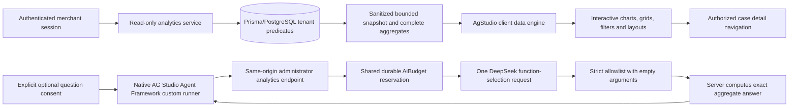

# Phase 6 — Return Intelligence with AG Studio

Started 2026-11-11. Existing Phase 5 financial workflow and historical timestamp safeguards are preserved. No new PayPal operations are authorized or needed for dashboard testing. No Phase 7 work.

## Narrow implementation plan

1. Review Phase 5 security boundaries, official Studio installation/report/data/agent documentation and actual package compatibility. Install matching official Studio 3.1.0 packages without framework upgrades.
2. Add a tenant-scoped read-only analytics projection, integer-money aggregation, conservative timestamp provenance and bounded/paginated case exploration. Expose sanitized fields only. Separate verified Sandbox refunds, synthetic cases and configured modeled estimates.
3. Replace the analytics placeholder with a branded client-only AgStudio dashboard: preconfigured charts/grids, economics comparisons, filtering, view/edit layout control and case drill-through. Add loading/error/empty behavior and desktop/mobile checks.
4. Evaluate the Agent Framework and DeepSeek's actual tool protocol. Only add an adapter if bounded server mediation and shared persistent budget accounting can be implemented and tested safely. A blocked optional agent must remain explicitly labeled unavailable, never simulated.
5. Run typecheck/lint/unit/integration/direct integration/Prisma/build/E2E, inspect screenshots and update sponsor/privacy/licensing/demo evidence. Record actual results separately from plans.

Files expected: package/lock; new analytics contracts/calculations/service/API/client components; existing analytics route; focused tests and documentation. Avoid payment/provider rewrites and unnecessary schema changes.

## Preflight

Read AGENTS, blueprint, architecture and Phase 5 report; inspected case financial binding, exact merchant authorization, existing evidence service and Prisma records. No blocking high-severity defect identified in this targeted review. Dashboard code must not call mutable case synchronization helpers, provider APIs or financial services. This is not independent security sign-off.

Official installation/quick-start/Agent Framework documentation reports Studio 3.1.0. npm metadata confirms React 17/18/19 peers, matching ag-studio 3.1.0, AG Grid ~36.3.0 and AG Charts ~14.3.0. Local evaluation is unlicensed with watermark; production needs an appropriate trial/commercial licence. No entitlement or sponsor award is claimed.

Status: implemented and locally verified, including native Studio reports, genuine DeepSeek tool selection/display and the complete regression suite. Phase 7 has not started.

## Implemented architecture



Actual packages: `ag-studio-react@3.1.0` and `ag-studio@3.1.0`, with matching AG Grid ~36.3.0 and AG Charts ~14.3.0 dependencies. Existing React/Next/Prisma versions are unchanged. npm install reported zero vulnerabilities. Studio is dynamically loaded with SSR disabled inside a client boundary; auth/projection remain on the server. Stable theme/layout/module references follow Studio's React guidance.

The dashboard has Return overview, Economics lab and Case explorer views. Actual Studio widgets include grouped bar charts, a line chart and grids, driven by its local engine and explicit field definitions. Native filtering/cross-filtering and edit mode let merchants build/resize/configure widgets. Save/Reset retain report state per merchant/view in browser session storage, with no business-data writes. A branded theme, configured chart palette and responsive single-column Studio breakpoints match the application. No custom visualization widget is claimed; application summary cards complement the actual Studio report.

## Data definitions and privacy

- Complete database aggregates: filtered return count/status counts, completed verified USD Sandbox refunds, unresolved refund operations, evidence-analysis activity. Financial totals require a retrieved completed ProviderRefund linked to a reconciled payment with a capture. Count is refund records, not captures or customers.
- Chart/economics cohort: latest 500 matching cases, explicitly labeled with coverage/truncation. Case-detail links use separate 25-row database pages across the full matching population. Filtering by source, category and trusted time window runs on the server. No PayPal/DeepSeek call occurs on viewing/filtering/customizing charts.
- Synthetic scenarios are labeled separately from Sandbox orders. AI evaluation fixtures (`AI-EVAL-*`) are excluded from merchant decision metrics. All fixture references in tests remain mocked; genuine records are never fabricated by analytics.
- Modeled economics use immutable persisted evaluation snapshots, accepting known logic versions and checking integer formulas/nonnegative cost inputs. Unreviewed, manual, missing, invalid or currency-mismatched snapshots contribute no unsupported comparison. Compare full physical-return cost with the recommended equivalent full remedy; never count a partial settlement as full-refund savings. Estimates describe the decision snapshot, not current refundable capacity or realized savings.
- Return processing = configured shipping + handling/disposal. Recovery = configured recoverable-value estimate. Avoidance = physical-return baseline minus recommended equivalent full-remedy cost, summed with BigInt. Studio chart values remain exact safe integer USD cents; UI totals use existing money formatting.
- Trends require explicit modern submission timestamps and trusted UTC/synthetic provenance. Unknown historical timestamps remain visible only in non-time metrics, marked excluded from trends. Date-filtered financial metrics exclude orders with untrusted timing. Historical data is never shifted or repaired.
- Analytics SELECTs run in a read-only repeatable-read transaction, recheck active merchant access, and use tenant predicates throughout. No mutable case-sync/provider helper is called. Projections contain product/category, internal case reference, bounded statuses/reasons, economics and timestamps; no customer email/reference/description, capability, image, storage key, provider credential or full provider ID is exported.
- Responses are no-store. Strict filter schemas reject tenant overrides and arbitrary query/action fields. Client state and saved layouts are scoped to merchant workspace; an account switch remounts the dashboard, aborts old loads and rejects mismatched response/workspace context. Staff can explore data; only active administrators can spend on queries.

## Actual Agent Framework integration

Used Studio's `AgStudioAiModule`, `createAiHarness` with a custom-runner agent, native assistant panel/thread UI and prompt starters. AG ships no provider adapter. This implementation uses the documented custom-runner boundary instead of pretending the example OpenAI Responses adapter is a drop-in DeepSeek adapter. The UI package supplies the full Studio API at runtime; its broader core-only setup declaration requires a documented TypeScript boundary cast before `createAiHarness`.

DeepSeek's current official Chat Completions tool-call contract supports `deepseek-flash`, non-thinking mode and function calls. The server calls `/chat/completions` with `thinking.type=disabled`, one required function selection and 256 maximum output tokens, a 20-second timeout and 32-KiB response cap. Strict Zod parsing accepts exactly one supported tool with `{}` arguments, valid usage and tool-call finish status. Parallel calls, arbitrary names/arguments, malformed output, missing usage and provider failures fail safely. No Responses API compatibility or unrestricted autonomous dashboard agent is claimed.

Read-only tools: common return reasons, equivalent resolution comparison, configured recovery by category, verified Sandbox refund totals and return overview; unsupported questions receive a clear limitation. DeepSeek chooses the tool; exact answer text/facts are computed from authorized server aggregates. No second model request is needed, and no model-generated money, SQL or financial decision is used. Tool call/result events and the final answer appear in Studio's actual conversation UI. Each question is independent; prior chat text/browser schemas/tools are not trusted or forwarded.

The user must opt in before the assistant is mounted. Only their bounded question and fixed tool schemas go to DeepSeek; no case rows, photographs, descriptions or aggregate business values are transmitted. Contact/link/credential patterns and action requests are blocked before inference. The provider's China/retention considerations apply to voluntarily entered question text; do not type personal information. Thread history is in browser memory, not a new server conversation archive.

## Spending and persistence

Additive migration `202611110002_analytics_queries` adds AnalyticsQuery and tenant/user/budget foreign keys, unique cache key, bounded status/amount checks and merchant/time index. Development/test migrations were applied without modifying existing payment records. Raw questions are not persisted; only hashes, model/prompt/snapshot identity, selected tool, safe result, usage/cost/error metadata and actor ownership.

The same `deepseek-global-v1` AiBudget used by evidence requests is locked before reserving a conservative bound. Spent plus reserved plus the new bound must fit `AI_SPENDING_CAP_USD`. No database transaction spans provider I/O. Identical query/snapshot/model/prompt/merchant requests deduplicate durably, including concurrent requests. Successful unchanged results are cached; reserved/unknown/failed requests are not automatically replayed. At most six new questions per merchant per five minutes; cache reads are free. A restart preserves claims. An abandoned reservation requires operator investigation, not an automatic release/retry.

Actual usage uses existing conservative peak token pricing. Documented unbilled rejections settle at zero. Missing/uncertain usage consumes the reserved maximum conservatively, preventing overspend through retries. Actual usage above the bound blocks the shared budget. Evidence analysis itself is unchanged; its UI spend label now explicitly identifies evidence-only usage.

## Actual verification

Genuine local verification (2026-11-12 client date): one persisted successful `deepseek-flash` Chat Completions request selected `verified_refunds`, with **589 input tokens, zero cached input, 17 output tokens, 1,004 ms latency**, and **197,100 nano-USD ($0.0001971)** estimated cost. Native Studio displayed the exact server result: three completed verified Sandbox refund records totaling 600 cents, zero pending operations. These are the preserved 40/60/500-cent refunds, not new PayPal operations. The corrected UI rerun was a cache hit with **zero new analytics requests**, unchanged payment/refund-operation counts and unchanged evidence-analysis attempts. Sanitized proof is in ignored `.local/evaluation/analytics-report.json`.

The genuine dashboard shows seven tenant return cases, three excluded historical dates, $6.00 verified refunds and $15.75 modeled advantage across three comparable snapshots. Source-filtered synthetic scenarios retain the original $13 modeled difference; the extra $2.75 is the Phase 5 Sandbox case's configured economics. None of this is a measured merchant saving. Genuine desktop/mobile chart screens and the native desktop assistant screenshot were visually inspected. The assistant deliberately returns exact tool-built facts instead of model-written financial prose.

Final visual review found clipped native edit/chat content at phone widths. The integration therefore explicitly disables layout editing and the optional assistant at widths up to 720px, with a clear explanation. Responsive reports, charts, filters, grids, Save/Reset and case navigation remain available on mobile. Resizing between these modes remounts Studio in view mode. Browser tests assert this availability boundary and verify that mobile viewing sends no analytics inference request.

During genuine UI testing the backend completed a valid DeepSeek tool selection, but the first custom runner emitted a compact text-chunk event that Studio's bare-runner message view did not expand. The tool appeared without its final answer. Replaced it with explicit TEXT_MESSAGE_START/CONTENT/END events and added native-panel/cache browser coverage. The assistant is an edit-mode panel; an explicit Open AI assistant control now opens it and collapses unrelated editing panes. Initial panel-discovery failures occurred before inference; subsequent identical questions use the persisted successful cache. No financial operation is available in the smoke helper.

| Command/check | Final observed result |
| --- | --- |
| `npm.cmd run typecheck` | Passed |
| `npm.cmd run lint` | Passed, zero warnings |
| `npm.cmd test` | 146 passed; 17 new analytics/provider tests, existing 129 preserved |
| `npm.cmd run test:integration` | 102 passed; 15 new analytics/agent tests, existing 87 preserved |
| `npx.cmd vitest run --config vitest.integration.config.ts` | 102 passed, mandatory isolation active |
| `npm.cmd run db:generate`, `db:migrate:test`, `db:migrate` | Additive accounting migration generated/applied successfully |
| `npm.cmd run db:validate` | Valid schema |
| `npx.cmd prisma migrate status` | Seven migrations, up to date |
| `npm.cmd run build` | Passed, including `/api/analytics` and `/api/analytics/ask` |
| `npm.cmd run test:e2e` | 34 passed, desktop/mobile, final rerun 4.9 minutes including Windows server cleanup, exit 0; existing 28 preserved |
| `npx.cmd tsx scripts/verify-analytics-ui.ts --live` | Genuine stored DeepSeek tool result displayed; cached rerun, no additional request; desktop/mobile reports verified |
| `npx.cmd tsx scripts/check-client-secrets.ts` | 31 client files, two configured provider secrets checked, zero leaks; values never printed |
| `git diff --check` | Passed; Windows LF/CRLF notices only |
| Existing local app health | HTTP 200 on port 3000 |

The final pipeline stopped on any failing command and completed successfully. No tests were removed, skipped or weakened. Initial browser selectors were corrected for multiple native chart status elements and the Send button's actual accessible name **Send message**; a longer timeout applies only to the new multi-view workflow. The 502-case synthetic fixture was corrected to include required policy snapshot/condition fields; the database constraint stayed intact. A licence registration side effect was moved out of React render after lint caught it. One existing payment test and one fixture transaction timed out under transient load; final sequential complete runs passed without changing their assertions or timeout. The earlier stopped/duplicate PostgreSQL startup attempt was not a reset; read-only connectivity confirmed the existing running cluster. Vite native-loader, pg future-version deprecation and color-environment warnings are non-failing. No remote CI, deployment or independent security sign-off is claimed.

After the mobile availability adjustment, typecheck, lint, production build and the entire 34-test browser suite passed again. The restricted Windows runner completed all assertions but stalled while terminating its server. A read-only process check verified the owned Next.js server on port 3100; PowerShell Stop-Process failed, Windows taskkill terminated only that server, and Playwright then exited 0 with 34 passed (4.9 minutes). The port-3000 development server was untouched. The final read-only bundle scan initially hit the Windows sandbox's tsx user-lookup restriction, then passed outside that restriction: 31 files, both configured provider secrets checked, no leaks. Mobile availability screenshot `artifacts/analytics-agent-availability-mobile.png` and the genuine desktop assistant screenshot were inspected.

## Reproduce locally and show judges

```powershell
npm.cmd ci
npm.cmd run db:generate
# Keep the existing PostgreSQL service running; db:local only if it is stopped.
npm.cmd run db:migrate
npm.cmd run db:migrate:test
npm.cmd run dev
# Use the existing README auth:link command privately; open /analytics.
```

No PayPal or AI credential is needed for synthetic chart exploration. Existing genuine records appear only when present in that merchant's database. Optional AI reuses the existing private DeepSeek setup and `AI_SPENDING_CAP_USD`; viewing/filtering charts never spends it.

Judge walkthrough: show verified Sandbox refund totals separately from modeled avoidance; filter **Synthetic scenarios** to reproduce the $13 Phase 3 comparison; open **Economics lab** and select/chart fields to investigate physical-return versus returnless estimates; select **Customize view** to configure native widgets and **Save layout**. Use **Case explorer** and the paginated case links to inspect the decision/audit behind a result. Turn on consent, choose **Open AI assistant**, then **Verified Sandbox refunds** for a native framework analytical workflow. Explain that DeepSeek selects a safe tool and the server supplies the exact facts. Do not type personal information or show `.env`, private links or credentials.

```powershell
npm.cmd run typecheck
npm.cmd run lint
npm.cmd test
npm.cmd run test:integration
npx.cmd vitest run --config vitest.integration.config.ts
npm.cmd run db:validate
npx.cmd prisma migrate status
npm.cmd run build
npm.cmd run test:e2e
# Separate, optional development-data UI smoke; starts its own server on 3202:
npx.cmd tsx scripts/verify-analytics-ui.ts
# Explicit paid-provider verification under the existing shared cap:
npx.cmd tsx scripts/verify-analytics-ui.ts --live
```

The smoke helper refuses to reuse an unknown port-3202 service, uses private local auth, blocks financial/evidence endpoints, captures desktop/mobile screenshots and stores a sanitized report in ignored `.local/evaluation/analytics-report.json`. `--live` opts into one supported analytics question; identical successful questions use the cache. Never treat mocked browser output as genuine provider proof. Routine browser tests disable provider credentials and exercise the runner through an injected mock.

CI explicitly disables AI and clears provider secrets, and runs both npm and direct Vitest integration entry points. Genuine helpers are never part of CI. The workflow was updated locally; no remote CI execution is claimed.

Screenshot artifacts: `artifacts/analytics-genuine-{overview,economics}-{desktop,mobile}.png`, `artifacts/analytics-genuine-agent-desktop.png`, plus mocked browser screenshots under `artifacts/analytics-*`. These are local verification assets; choose sanitized screenshots deliberately for submission rather than uploading all test artifacts.

## Changed files

- Dependencies/configuration: `package.json`, lockfile, `.env.example`, CI workflow; no framework/library upgrade beyond adding Studio's matched dependencies.
- Schema/accounting: `prisma/schema.prisma`, `202611110002_analytics_queries/migration.sql`.
- Projection/money contracts: `src/lib/analytics/{contracts,calculations,agent,deepseek-tools}.ts`.
- Server: `src/server/services/{analytics,analytics-agent}.ts`, `src/server/analytics-http.ts`, `api/analytics` and `api/analytics/ask`.
- UI: merchant analytics page/loading/error, `src/components/analytics/{intelligence-dashboard,studio-canvas,studio-report,analytics-harness}`, evidence spend-label clarification only.
- Tests: analytics/unit and provider/unit suites; analytics/integration and agent/integration suites; analytics browser suite; existing navigation test's expected analytics heading updated.
- Operator proof: `scripts/verify-analytics-ui.ts`, `scripts/check-client-secrets.ts`; README, architecture, progress, decisions, sponsor evidence, Phase 5 demo addendum and this report.

Earlier Phases 2–5 uncommitted files remain intact and are not claimed as Phase 6 additions. No commit, deployment, production PayPal switch or new financial transaction was performed.

## Licensing and delivery limitations

Local unlicensed evaluation retains vendor warnings/watermark. Configure an appropriate Studio licence (including AI entitlement) in ignored `.env` as `NEXT_PUBLIC_AG_STUDIO_LICENSE_KEY` and rebuild for hosted use. This browser entitlement is intentionally public and registered once through `AgStudioLicenseManager` before component creation; provider API secrets remain server-only. No actual licence is checked in or entitlement claimed. Verify commercial/demo terms with AG Grid before public deployment. The application's MIT licence does not relicense commercial dependencies.

No arbitrary SQL, raw customer analytics, automatic report generation, autonomous chart editing agent, shared multi-device layout storage, queue or analytics scheduler is implemented. These limits preserve a useful bounded dashboard and financial isolation. No production readiness or prize eligibility is asserted by installing the packages. Phase 7 is not started.

Question screening detects common contact/link/credential patterns; it is not a general personal-data detector. Enter aggregate analytical questions only. Hosted real-customer use still requires the existing provider/privacy/retention review, least-privilege database/runtime controls, private durable evidence storage, shared ingress limits and independent financial security review. Native chat and edit-mode customization are desktop-only; mobile view mode uses native responsive layouts, with grids scrolling inside Studio. Optional chat history is in memory and resets when the report/scope is remounted. Abandoned AI reservations need operator investigation. The existing historical timestamp uncertainty and Phase 5 webhook-delivery limitation remain unchanged.

Official sources read: [installation](https://www.ag-grid.com/studio/react/installation/), [quick start](https://www.ag-grid.com/studio/react/quick-start/), [dashboard tutorial](https://www.ag-grid.com/studio/react/tutorial/), [data modelling](https://www.ag-grid.com/studio/react/data-modelling/), [responsive layout](https://www.ag-grid.com/studio/react/responsive-layout/), [theming](https://www.ag-grid.com/studio/react/theming/), [React practices](https://www.ag-grid.com/studio/react/react-best-practices/), [Agent Quick Start](https://www.ag-grid.com/studio/react/ai-quickstart/), [DeepSeek tool calls](https://api-docs.deepseek.com/guides/tool_calls/) and [Chat Completions](https://api-docs.deepseek.com/api/create-chat-completion/). Custom-widget and Responses API documentation were also investigated; no custom-widget or Responses transport integration is claimed.
