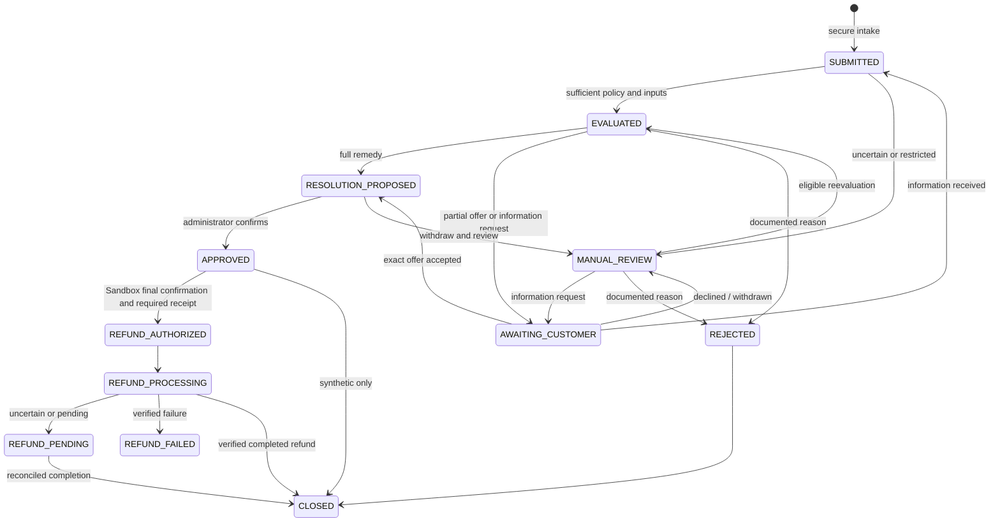

# Return management — Phase 3

## Local setup and demonstration (PowerShell)

Keep `npm.cmd run db:local` running if using the supplied local PostgreSQL cluster. Existing `.env` names remain unchanged; Phase 3 needs no new secrets, AI key or PayPal credentials. Configure `DATABASE_URL`, a genuinely separate `TEST_DATABASE_URL` ending `_test`, and `APP_BASE_URL` privately as described in README. Never paste credentials into chat or commit `.env`.

```powershell
npm.cmd run db:generate
npm.cmd run db:migrate
npm.cmd run db:migrate:test
npm.cmd run returns:seed
npm.cmd run dev
# In another terminal, issue a private administrator login link:
npm.cmd run auth:link -- --email=admin@oakandloom.example --merchant=11111111-1111-4111-8111-111111111111
```

The seed preserves existing rows, timestamps and policies, including the fully refunded genuine $1 Sandbox payment. It creates no provider records and makes no PayPal requests. Run it once for fresh scenarios; rerunning does not reset submitted cases or refresh expired purchase dates. If an existing return policy is configured, it is preserved and the new scenarios use that policy, so outcomes may differ from the defaults below.

1. Sign in privately. Open **Settings** to inspect the return policy; save creates a new immutable version for future submissions only. Existing standalone PayPal review policies stay separate.
2. Open **Return cases**. `RW-DEMO-A` recommends full refund without return; `RW-DEMO-B` recommends physical return; `RW-DEMO-C` requires human assessment.
3. Open **Customer portal**, find `RW-DEMO-INTAKE`, and create a private link. Verify the intended recipient before sharing. Open it in a separate browser context, click **Open my return**, choose the item/reason/condition and submit a description. Save the new case-access link displayed after submission; the intake link is now consumed.
4. In the merchant case detail, inspect the frozen policy, inputs, cost comparison, limitations and history. Select an eligible resolution, document its exact terms (and any departure from the recommendation), confirm rights/entitlement review, and propose it.
5. For a partial offer, the customer must explicitly accept the exact amount and terms using case access. A decline returns the case to manual review. An expired offer must be withdrawn through manual review and evaluated/proposed again.
6. Record merchant approval with the confirmation dialog. **No PayPal operation occurs.** Physical-return proposals still need return/inspection controls before any later payment orchestration. Information requests, manual review, rejection and closure are also available; stale concurrent actions require refresh.

## Policy and financial logic

Policy fields cover the UTC elapsed-day window from purchase, included/excluded categories, allowed reasons, conditions needing review, returnless/partial permission, absolute and basis-point partial ceilings, shipping responsibility, explicit logistics/processing estimates, recovery source and high-value threshold. Defaults are conservative: returnless/partial disabled and unknown recovery. Other/unknown issues and unknown condition always require review; merchant configuration cannot disable this fallback. Standard-window restrictions are review flags, not conclusive legal denials.

For one item and USD integer cents:

```text
physical return = full refund + merchant shipping + handling + disposal - recovery
keep item       = full refund + unavoidable keep processing
advantage       = physical return cost - keep item cost
partial keep    = exact optional partial amount + unavoidable keep processing
```

Customer-paid shipping is displayed separately. Only equally permitted full-refund remedies are ranked. A partial amount must be positive, less than the item amount and within both configured ceilings; it is never ranked as a cheaper substitute for full-refund rights. All money arithmetic uses BigInt; percentages use integer basis points with floor division.

| Synthetic case | Refund | Shipping + handling | Recovery | Return cost | Keep cost | Expected result |
|---|---:|---:|---:|---:|---:|---|
| A — damaged bowl | $80 | $25 | $12 | $93 | $80 | Full refund, keep item |
| B — recoverable lamp | $240 | $25 | $180 | $85 | $240 | Physical return |
| C — ambiguous textile | $60 | Configured estimate | Configured estimate | Not recommended | Not recommended | Manual review |

These are modeled examples, not measured savings or provider-verified transactions. The genuine $1 capture remains fully refunded and unavailable for further refunds.

Missing/invalid inputs, recovery above item value, shipping above item price, currency mismatch, unverified capture, unreconciled ledger, held refund reservations, a fully or partly refunded payment, unknown purchase provenance, future purchase dates and policy restrictions produce structured manual-review results. No network call is made by the economics engine.

`src/lib/returns/contracts.ts` owns validation; `engine.ts` owns pure economics/eligibility; `state.ts` owns allowed transitions. `src/server/services/returns.ts` owns scoped persistence, customer access and merchant workflow. Existing PayPal services remain separate. An evaluation persists inputs, canonical hash, logic version, options, reason codes and missing information. Approval serializes with ledger updates and checks current money/timing against those inputs; changed inputs require reevaluation. No financial reservation is made by Phase 3 approval.

## State machine and history



Other permitted review/rejection edges are defined in `state.ts`. Every mutation checks case version under a row lock and appends an audit event. Evaluation records, return-policy versions, case policy snapshots and proposal terms are protected by database triggers. Composite foreign keys enforce tenant ownership. Customer responses bind case, exact proposal hash, version and expiry. A single existing order cannot be submitted twice.

## Security, privacy and limitations

- Only active authenticated administrators can issue/revoke customer access, change policies or resolve cases. Staff can read tenant-scoped pages. Customer capabilities are independent of merchant sessions.
- Random 256-bit capability tokens are stored as hashes. Single-use intake expires in one day; case tracking in seven. A replacement revokes previous links for that order. Tokens travel in URL fragments, are cleared on opening, and are posted in bounded same-origin JSON bodies. Never share a private link in screenshots, support logs or public demos.
- Customer projections omit customer references, provider IDs, credentials and merchant economics. React escapes descriptions. No public order-ID lookup or image upload exists.
- Sensitive customer endpoints have bounded per-token and process-wide limits. Multi-instance/public deployment requires shared ingress limits, HTTPS, least-privilege runtime DB access and a reviewed recipient-verification/delivery process.
- Text is bounded (4,000 characters intake; 1,500 follow-up/terms). Audit history is append-only. No automatic historical-data deletion or retention purge is implemented; define retention and restricted archival before real customer use. Access expiry limits access, not storage lifetime.
- Historical records are never repaired automatically. See the timestamp assessment in the verification report. New cases use explicit UTC submission times and trusted purchase provenance. Legacy cases remain manual.
- Single-item orders, one case per order, USD, configured estimates and human eligibility review are intentional scope limits. Partial acceptance is a private-link-holder agreement, not independently verified customer identity.
- Phase 4 adds private photo storage/validation and consent-based DeepSeek observations; Phase 5 connects case refunds through a separate final authorization. See [current orchestration and verification](phase-5-orchestration.md). Recommendations cannot establish legal rights. Synthetic images and genuine provider operations are labeled separately.

## Verification and Phase 4 prerequisites

```powershell
npm.cmd run typecheck
npm.cmd run lint
npm.cmd test
npm.cmd run test:integration
npx.cmd vitest run --config vitest.integration.config.ts
npm.cmd run db:validate
npx.cmd prisma migrate status
npm.cmd run build
npm.cmd run test:e2e
npx.cmd tsx scripts/audit-return-timestamps.ts # read-only development inventory
```

Both integration entry paths require explicit isolated test configuration before Prisma construction, migration or fixture writes. Browser tests use port 3100 and the verified test database, with provider credentials disabled. They never refund real Sandbox captures. Results are recorded in [Phase 3 verification](phase-3-verification.md).

Phase 4 must first define private evidence storage with MIME/size limits and signed scoped access, retention and redaction, then a strict observation-only AI schema with a manual fallback. Preserve deterministic amounts, immutable inputs and human rights review. Review customer-acceptance identity and later case-to-refund orchestration separately; approval must revalidate entitlement, current provider balance, return receipt where necessary and persistent financial idempotency. No AI or AG Studio code is included here.
